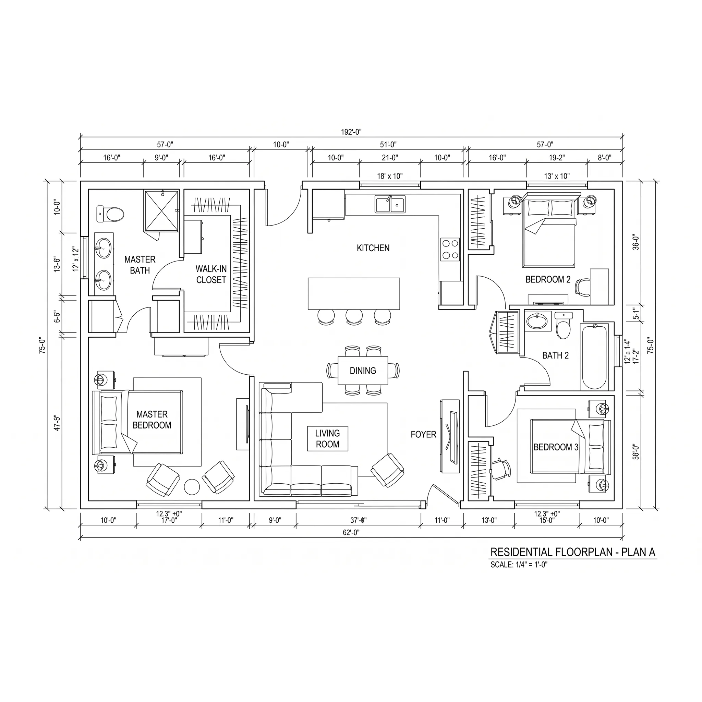

# ZeroBias Physical Space Pipeline Templates

Pipeline templates that load physical space data (floor plans, spaces, openings, assets, objects). One template per `*.yml` in this directory:

| File | Template | Collector |
|---|---|---|
| `floor-plans.yml` | Floor Plans | `@zerobias-org/collectorbot-zerobias-zerobias-dynamic` |

`floor-plans.yml` is for every product of the dataproducer interface (`interface: "@zerobias-org/module-interface-dataproducer"`), so a pipeline created from it names the boundary product it is for. It needs the Drawable/Canvas model of the base schema (`@auditlogic/schema-zerobias-zerobias-base` 5, auditlogic/schema PR #228) on the environment, and a dataloader that reads `interface` (zerobias-com/platform#226).

## Floor Plans

The Floor Plans template (`floor-plans.yml`, id `0201bd60-e171-491f-9751-e80be61dd7b3`) loads a floor plan workbook
into a boundary through the dynamic collector, one sheet per class.

### The files it ships

| File | What it is |
|---|---|
| [files/floorplan.xlsx](files/floorplan.xlsx) | Sample workbook: plan A of a house, 103 records. Its `_README` sheet sums up the format. |
| [files/floorplan.webp](files/floorplan.webp) | The drawing the workbook describes (2048 × 2048 px) |

The template lists both in `params.requiredFiles`, and `package.json` lists them in `files` and
`zerobias.catalog-files`, so every load of the template stores them in fileservice's shared catalog. A pipeline
created from the template gets its own copies, attached as `floorplan.xlsx` and `floorplan.webp`. Each mapping's
source names the workbook and its sheet, such as `file: { name: floorplan.xlsx, containerPath: /File }` for the File
sheet, and the platform links it to the pipeline's copy, so the new pipeline is ready to run and loads the sample. To
load your own floor plan, overwrite the two files from the pipeline in the UI: every run reads their current versions.



### What it loads

```
File ◄────── file ────── FloorPlan  (a Canvas: the drawing)
                             ▲
                             │ canvases  + planPosition: the box on the drawing, in pixels
                             │
                         PhysicalSpace ◄──── connects  + spaceAccess: side, hinge, swing ──── PhysicalOpening
                             ▲
                             │ placedIn  + placement: where it sits in its parent
                             │
          PhysicalSpace · PhysicalOpening · PhysicalAsset · PhysicalObject
```

The sample loads 1 File, 1 FloorPlan, 16 PhysicalSpace, 19 PhysicalOpening, 57 PhysicalAsset and 9 PhysicalObject
records, with 16 canvases links, 89 placedIn links and 29 connects links.

### Ids are unique to the pipeline

Every mapped id, and every reference to one (a floor plan's `file`, the `placedIn` links, a space's `canvases` and an opening's `connects`), is prefixed with the pipeline's id: `$pipelineId & "/" & id`, so `plan-a/space/hall` is stored as `<pipelineId>/plan-a/space/hall`. The platform's linker resolves a reference by id across the whole org, so without the prefix every pipeline that loads the same workbook would link its records to every other's. `$pipelineId` is bound by the dynamic collector, so a pipeline needs collector 1.1.2 or later: without it, JSONata reads the variable as an empty string and ids come out as `/plan-a/...`.

### Preparing the workbook

Start from `floorplan.xlsx`: keep its sheets and headers, and replace the rows.

#### Rules for every sheet

| Rule | Details |
|---|---|
| Sheet names | Exactly `File`, `FloorPlan`, `PhysicalSpace`, `PhysicalOpening`, `PhysicalAsset`, `PhysicalObject`. The pipeline finds each sheet by its name. Other sheets (`_README`, `Empty`) aren't loaded. |
| Keep all six | If you have nothing for a sheet, leave its header row and no records. |
| Headers | Row 1, spelled exactly as below (case matters). Column order doesn't matter. The template ignores columns it doesn't read. |
| Records | One per row from row 2, with no blank rows in between. |
| `id` | Required. Unique within its sheet and kept from run to run: the next run matches rows by `id`. Use readable paths such as `plan-a/space/kitchen`. |
| `name` | Required. |
| Blank cell | Not set. |
| Numbers | Plain numbers with a `.` decimal point, without units or thousands separators. |
| Allowed values | Upper-case codes exactly as listed below. |
| Booleans | `TRUE` / `FALSE` |
| Units | Every length has its own `.unit` column, and nothing is converted on load. Allowed units: `FOOT`, `INCH`, `METRE`, `CENTIMETRE`, `MILLIMETRE`, `PERCENT` (of the parent's size on the same axis). |
| Coordinates | `x` runs across and `y` runs down the drawing, measured from the parent's top-left corner as drawn. |
| Links | The `id` of a row in another sheet, or in the same sheet. For multi links, join the ids with `" \| "`. |
| Link data (t3) | `<link>.<t3>.<field>` columns describe the link itself. For a multi link, list the values in the same order as the ids, joined with `" \| "`. Leave a position empty to skip it. |

#### Columns

**File**: the drawing. It loads first.

| Column | Required | Value |
|---|---|---|
| `id` | yes | e.g. `plan-a/file/drawing` |
| `name` | yes | file name; taken from the attached drawing, see [The drawing](#the-drawing) |
| `fileVersionId` | yes | taken from the attached drawing; without one, a file version in your org's file service |
| `size` | yes | bytes; taken from the attached drawing |
| `mimeType` | | e.g. `image/webp`, `image/png`, `image/svg+xml`, `application/pdf`; taken from the attached drawing |
| `note` | | |

**FloorPlan**: one row per drawing of one level.

| Column | Required | Value |
|---|---|---|
| `id`, `name` | yes | |
| `note` | | |
| `extent.width`, `extent.depth`, `extent.unit` | | real-world size the drawing covers. The scale is `calibration.imageWidth / extent.width` pixels per unit. |
| `calibration.originX`, `calibration.originY` | | pixel on the image where the drawn area's top-left corner sits |
| `calibration.imageWidth`, `calibration.imageHeight` | | image size in pixels |
| `file` | | `id` of the File row |

**PhysicalSpace**: rooms, corridors and zones.

| Column | Required | Value |
|---|---|---|
| `id`, `name` | yes | |
| `description`, `note` | | free text |
| `sourceSystem` | | what produced the data, e.g. `floorplan-mapper` |
| `spaceType` | | `ROOM`, `CORRIDOR`, `ZONE`, `OTHER` |
| `extent.width`, `extent.depth`, `extent.unit` | | size of the space |
| `footprint.kind`, `footprint.unit`, `footprint.vertices` | | outline, if it isn't a plain box: `POLYGON`, with vertices `x,y \| x,y \| …` measured from the space's top-left corner. The template reads no other shape sizes. |
| `placedIn` | | `id` of the space it lies in, e.g. a room in a zone |
| `placedIn.placement.x`, `.y`, `.unit` | | where its top-left corner sits in that space |
| `canvases` | | `id` of each FloorPlan it is drawn on, joined with `" \| "` |
| `canvases.planPosition.x`, `.y`, `.width`, `.height` | | its box on each drawing, in that image's pixels, from the top-left corner |

**PhysicalOpening**: doors, gates, turnstiles, windows and barriers.

| Column | Required | Value |
|---|---|---|
| `id`, `name` | yes | |
| `description`, `note`, `sourceSystem` | | as above |
| `entryType` | | `DOOR`, `GATE`, `TURNSTILE`, `ELEVATOR`, `PARKING_GATE`, `SECURITY_CHECKPOINT`, `EMERGENCY_EXIT`, `VEHICLE_BARRIER`, `MANTRAP`, `WINDOW`, `OTHER` |
| `operation` | | `SWING`, `DOUBLE_ACTION`, `SLIDING`, `SECTIONAL_OVERHEAD`, `ROLL_UP`, `BI_FOLD`, `REVOLVING`, `PIVOT`, `FIXED`, `NONE` |
| `boundary` | | `INTERNAL` (joins two spaces) or `EXTERNAL` (leads outside; connects one space) |
| `extent.width`, `extent.depth`, `extent.unit` | | size of the opening |
| `placedIn`, `placedIn.placement.*` | | the space it is drawn in, and where |
| `connects` | | `id` of each space it opens into, joined with `" \| "` |
| `connects.spaceAccess.side` | | per space: `INSIDE` (the secured side), `OUTSIDE`, `EITHER` |
| `connects.spaceAccess.hinge` | | per space, as seen from it: `LEFT`, `RIGHT`, `TOP`, `NONE` |
| `connects.spaceAccess.swing` | | per space: `INWARD`, `OUTWARD`, `BOTH`, `NOT_APPLICABLE` |

**PhysicalAsset**: things of value you track (equipment, furniture, fixtures), and **PhysicalObject**: things you
don't track as assets. Both sheets take the same columns, except that only PhysicalAsset reads `virtual` and `footprint.*`.

| Column | Required | Value |
|---|---|---|
| `id`, `name` | yes | |
| `description`, `note`, `sourceSystem` | | as above |
| `kind` | | `EQUIPMENT`, `NETWORK_DEVICE`, `RACK`, `CABINET`, `FURNITURE`, `FIXTURE`, `CONTAINER`, `SAFETY_EQUIPMENT`, `SIGNAGE`, `VEHICLE`, `CONSUMABLE`, `OTHER` |
| `componentType` | | OSCAL component type: `physical` |
| `virtual` | | PhysicalAsset only: `TRUE` / `FALSE` |
| `extent.width`, `extent.depth`, `extent.unit` | | size |
| `footprint.*` | | PhysicalAsset only, as for PhysicalSpace |
| `placedIn` | | `id` of the space it is in, or of another asset or object it sits in or on (a server in a rack) |
| `placedIn.placement.x`, `.y`, `.unit` | | where its top-left corner sits in that parent |

#### The drawing

While the pipeline has `floorplan.webp` attached, the File row takes its `name`, `fileVersionId`, `size` and
`mimeType` from the drawing, not from its cells. They come from `$files`, which the dynamic collector binds next to
`$pipelineId`: the pipeline's attached files by name, each with its current version's `fileId`, `fileVersionId`,
`name`, `size` and `mimeType`. So the File record describes the drawing's current version, and follows it when you
overwrite the drawing.

The row's own cells are read only without the attachment, or on a collector that does not bind `$files`; in the
sample they hold a placeholder `fileVersionId` and the name `.floorplan.webp`. Every File row takes the attached
drawing, so keep one File row. If you have no drawing, delete the File row and leave `FloorPlan.file` blank. A File
row without a `fileVersionId` is rejected; the run still loads every other row and ends with status `warning`.

### Changing the data

| You change | Next run |
|---|---|
| a row | new version of the same record (matched by `id`) |
| nothing in a row | nothing for that record |
| a new row | new record |
| a deleted row | the record is deleted |
| an `id` | the old record is deleted and a new one is created |

- **Load order** is fixed by the template: File, FloorPlan, PhysicalSpace, PhysicalOpening, PhysicalAsset,
  PhysicalObject. Link data (planPosition, placement) is only written from the row that holds it, so drawings and
  parents load before what is drawn on or placed in them.
- **Each pipeline has its own records.** It reads its own copy of the workbook and prefixes ids with its own id, so
  two pipelines with the same floor plan make two copies of everything.
- **Start over:** point every mapping at the blank `Empty` sheet (`containerPath: /Empty`) and run: the run deletes
  everything the pipeline loaded. Point each mapping back at its own sheet and run again: one run reloads every record
  and link. Records keep their ids. Keep `Empty` blank: a sheet with any cell set is not empty.

### Known issues

- **Editing a parent drops what is placed in it.** On a run that changes the row of something other things are
  placed in (a room that holds assets, an asset that holds others), that record loses the `placedIn` links pointing
  into it. This is a platform bug, not yet fixed. To get the links back, start over (see above): one run reloads all
  links together.
