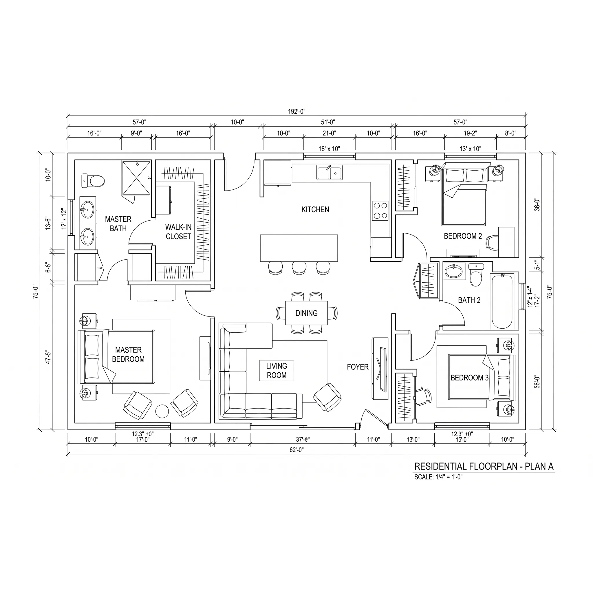

# OneDrive 365 Floor Plans: example and how-to

The **OneDrive 365 Floor Plans** template
([`onedrive-floor-plans.yml`](../../onedrive-floor-plans.yml), id
`0201bd60-e171-491f-9751-e80be61dd7b3`) loads a floor plan workbook kept in OneDrive or SharePoint into a boundary. It
reads the workbook through the Microsoft Graph Excel data producer and the dynamic collector, one sheet per class.

This folder holds a sample workbook, the drawing it describes, and a script that creates the pipeline through the API,
because the UI has no step for creating a pipeline from a template yet.

> **Where it runs:** the template needs the Drawable/Canvas model of the base schema
> (`@auditlogic/schema-zerobias-zerobias-base` 5). Today that model is only on **dev** (`ci.zerobias.com`).

| File | What it is |
|---|---|
| [`floorplan.xlsx`](floorplan.xlsx) | Sample workbook: plan A of a house, 103 records. The `_README` sheet sums up the format. |
| [`floorplan.webp`](floorplan.webp) | The drawing the workbook describes (2048 × 2048 px) |
| [`create-pipeline.sh`](create-pipeline.sh) | Creates, runs, checks, wipes and restores the pipeline with curl |
| [`pipeline.example.json`](pipeline.example.json) | The ids the script needs from you |



## What it loads

```
File ◄────── file ────── FloorPlan  (a Canvas: the drawing)
                             ▲
                             │ canvases  + planPosition: the box on the drawing, in pixels
                             │
                         PhysicalSpace ◄──── connects  + spaceAccess: side, hinge, swing ──── PhysicalOpening
                             ▲
                             │ placedIn  + placement: where it sits in its parent
                             │
          PhysicalSpace · PhysicalOpening · PhysicalAsset · PhysicalObject
```

The sample loads 1 File, 1 FloorPlan, 16 PhysicalSpace, 19 PhysicalOpening, 57 PhysicalAsset and 9 PhysicalObject
records, with 16 canvases links, 89 placedIn links and 29 connects links.

## Preparing the workbook

Start from `floorplan.xlsx`: keep its sheets and headers, and replace the rows.

### Rules for every sheet

| Rule | Details |
|---|---|
| Sheet names | Exactly `File`, `FloorPlan`, `PhysicalSpace`, `PhysicalOpening`, `PhysicalAsset`, `PhysicalObject`. The pipeline finds each sheet by its name. Other sheets (`_README`, `Empty`) aren't loaded. |
| Keep all six | If you have nothing for a sheet, leave its header row and no records. |
| Headers | Row 1, spelled exactly as below (case matters). Column order doesn't matter. The template ignores columns it doesn't read. |
| Records | One per row from row 2, with no blank rows in between. |
| `id` | Required. Unique within its sheet and kept from run to run: the next run matches rows by `id`. Use readable paths such as `plan-a/space/kitchen`. |
| `name` | Required. |
| Blank cell | Not set. |
| Numbers | Plain numbers with a `.` decimal point, without units or thousands separators. |
| Allowed values | Upper-case codes exactly as listed below. |
| Booleans | `TRUE` / `FALSE` |
| Units | Every length has its own `.unit` column, and nothing is converted on load. Allowed units: `FOOT`, `INCH`, `METRE`, `CENTIMETRE`, `MILLIMETRE`, `PERCENT` (of the parent's size on the same axis). |
| Coordinates | `x` runs across and `y` runs down the drawing, measured from the parent's top-left corner as drawn. |
| Links | The `id` of a row in another sheet, or in the same sheet. For multi links, join the ids with `" \| "`. |
| Link data (t3) | `<link>.<t3>.<field>` columns describe the link itself. For a multi link, list the values in the same order as the ids, joined with `" \| "`. Leave a position empty to skip it. |

### Columns

**File**: the drawing. It loads first.

| Column | Required | Value |
|---|---|---|
| `id` | yes | e.g. `plan-a/file/drawing` |
| `name` | yes | file name |
| `fileVersionId` | yes | from the file service upload, see [The drawing](#the-drawing) |
| `size` | yes | bytes |
| `mimeType` | | e.g. `image/webp`, `image/png`, `image/svg+xml`, `application/pdf` |
| `note` | | |

**FloorPlan**: one row per drawing of one level.

| Column | Required | Value |
|---|---|---|
| `id`, `name` | yes | |
| `note` | | |
| `extent.width`, `extent.depth`, `extent.unit` | | real-world size the drawing covers. The scale is `calibration.imageWidth / extent.width` pixels per unit. |
| `calibration.originX`, `calibration.originY` | | pixel on the image where the drawn area's top-left corner sits |
| `calibration.imageWidth`, `calibration.imageHeight` | | image size in pixels |
| `file` | | `id` of the File row |

**PhysicalSpace**: rooms, corridors and zones.

| Column | Required | Value |
|---|---|---|
| `id`, `name` | yes | |
| `description`, `note` | | free text |
| `sourceSystem` | | what produced the data, e.g. `floorplan-mapper` |
| `spaceType` | | `ROOM`, `CORRIDOR`, `ZONE`, `OTHER` |
| `extent.width`, `extent.depth`, `extent.unit` | | size of the space |
| `footprint.kind`, `footprint.unit`, `footprint.vertices` | | outline, if it isn't a plain box: `POLYGON`, with vertices `x,y \| x,y \| …` measured from the space's top-left corner. The template reads no other shape sizes. |
| `placedIn` | | `id` of the space it lies in, e.g. a room in a zone |
| `placedIn.placement.x`, `.y`, `.unit` | | where its top-left corner sits in that space |
| `canvases` | | `id` of each FloorPlan it is drawn on, joined with `" \| "` |
| `canvases.planPosition.x`, `.y`, `.width`, `.height` | | its box on each drawing, in that image's pixels, from the top-left corner |

**PhysicalOpening**: doors, gates, turnstiles, windows and barriers.

| Column | Required | Value |
|---|---|---|
| `id`, `name` | yes | |
| `description`, `note`, `sourceSystem` | | as above |
| `entryType` | | `DOOR`, `GATE`, `TURNSTILE`, `ELEVATOR`, `PARKING_GATE`, `SECURITY_CHECKPOINT`, `EMERGENCY_EXIT`, `VEHICLE_BARRIER`, `MANTRAP`, `WINDOW`, `OTHER` |
| `operation` | | `SWING`, `DOUBLE_ACTION`, `SLIDING`, `SECTIONAL_OVERHEAD`, `ROLL_UP`, `BI_FOLD`, `REVOLVING`, `PIVOT`, `FIXED`, `NONE` |
| `boundary` | | `INTERNAL` (joins two spaces) or `EXTERNAL` (leads outside; connects one space) |
| `extent.width`, `extent.depth`, `extent.unit` | | size of the opening |
| `placedIn`, `placedIn.placement.*` | | the space it is drawn in, and where |
| `connects` | | `id` of each space it opens into, joined with `" \| "` |
| `connects.spaceAccess.side` | | per space: `INSIDE` (the secured side), `OUTSIDE`, `EITHER` |
| `connects.spaceAccess.hinge` | | per space, as seen from it: `LEFT`, `RIGHT`, `TOP`, `NONE` |
| `connects.spaceAccess.swing` | | per space: `INWARD`, `OUTWARD`, `BOTH`, `NOT_APPLICABLE` |

**PhysicalAsset**: things of value you track (equipment, furniture, fixtures), and **PhysicalObject**: things you
don't track as assets. Both sheets take the same columns, except that only PhysicalAsset reads `virtual` and `footprint.*`.

| Column | Required | Value |
|---|---|---|
| `id`, `name` | yes | |
| `description`, `note`, `sourceSystem` | | as above |
| `kind` | | `EQUIPMENT`, `NETWORK_DEVICE`, `RACK`, `CABINET`, `FURNITURE`, `FIXTURE`, `CONTAINER`, `SAFETY_EQUIPMENT`, `SIGNAGE`, `VEHICLE`, `CONSUMABLE`, `OTHER` |
| `componentType` | | OSCAL component type: `physical` |
| `virtual` | | PhysicalAsset only: `TRUE` / `FALSE` |
| `extent.width`, `extent.depth`, `extent.unit` | | size |
| `footprint.*` | | PhysicalAsset only, as for PhysicalSpace |
| `placedIn` | | `id` of the space it is in, or of another asset or object it sits in or on (a server in a rack) |
| `placedIn.placement.x`, `.y`, `.unit` | | where its top-left corner sits in that parent |

### The drawing

`File.fileVersionId` points at a file in the ZeroBias file service of your org. The id in the sample belongs to the
dev org that made it, so upload your own drawing:

```bash
H=(-H "Authorization: APIKey $ZB_API_KEY" -H "dana-org-id: $ZB_ORG_ID")
curl -sS "${H[@]}" -H 'Content-Type: application/json' -X POST "$ZB_PLATFORM_URL/file-service/files" \
  -d '{"name":"floorplan.webp","retentionPolicy":{"retentionPolicyType":"forever"},"syncPolicy":{"syncPolicyType":"off"}}'
# → {"id": "<fileId>", ...}
curl -sS "${H[@]}" -H 'Content-Type: image/webp' --data-binary @floorplan.webp -X POST \
  "$ZB_PLATFORM_URL/file-service/files/<fileId>/upload?checksum=$(md5 -q floorplan.webp)"   # Linux: md5sum | cut -d' ' -f1
# → {"fileVersionId": "<paste into File.fileVersionId>", "size": <paste into File.size>, "status": "ready", ...}
```

If you have no drawing, delete the File row and leave `FloorPlan.file` blank. A File row without `fileVersionId` is
rejected; the run still loads every other row and ends with status `warning`.

### Where to keep it

Upload the workbook to a OneDrive or SharePoint drive that your Microsoft Graph connection can read, and edit it
there: every run reads the workbook as it is at that moment.

## Creating the pipeline

**You need:**
- an environment with the model and the template loaded (dev today)
- a boundary
- a Microsoft Graph connection (OneDrive 365) that can read the workbook. If the connection runs on your own hub node,
  that node must be online whenever the pipeline runs.
- an API key and your org id, plus `bash`, `curl` and `jq`

Work in a copy of this folder: the script reads `./pipeline.json` and writes to `./pipeline.out/`.

```bash
export ZB_PLATFORM_URL=https://ci.zerobias.com/api ZB_API_KEY=<key> ZB_ORG_ID=<org id>
cp pipeline.example.json pipeline.json     # set boundaryId and connectionId
./create-pipeline.sh connection            # status "up", and its scopes (leave scopeId blank if there is one)
./create-pipeline.sh browse /              # "sites" = Files & Sites
./create-pipeline.sh browse sites          # your site → its drive → folders → the workbook;
                                           #   write every id you go through into workbookPath, "/" first
./create-pipeline.sh browse <workbook id>  # the six sheets: the path is right
./create-pipeline.sh body                  # look at the request before sending it
./create-pipeline.sh create                # the pipeline id goes to pipeline.out/pipeline-id
./create-pipeline.sh run
./create-pipeline.sh jobs                  # repeat until completed (warning: some rows were rejected)
./create-pipeline.sh objects               # records the run wrote, per class
```

The template carries the mappings but no workbook, so `body` fills in, for each mapping (sheet):

| Field | Value |
|---|---|
| `context` | `scopeId`, `targetId` = the connection, `productId` = the template's, `boundaryId` |
| `source.objectId` | `sheet_<site>/<drive>/<item>/<Sheet>`: the workbook id with `item_` replaced by `sheet_`, plus `/<Sheet>` |
| `source.objectPath` | `workbookPath` |
| `source.schemaId` | `schema:collection:microsoft.azure.msgraph.sheet:<site>/<drive>/<item>/<Sheet>` |

The request's `params` replace the template's params key by key, so `body` sends the template's whole `dataMappings`
list with these ids filled in. The calls the script makes (headers `Authorization: APIKey <key>` and
`dana-org-id: <org id>`):

| Step | Call |
|---|---|
| Template | `GET /portal/pipelineTemplates/0201bd60-e171-491f-9751-e80be61dd7b3` |
| Connection, scopes | `GET /hub/connections/<connectionId>`, `GET /hub/connections/<connectionId>/scopes` |
| Browse | `PUT /hub/targets/<connectionId>/getChildren` `{"objectId": "/", "pageSize": 100}` |
| Create | `POST /platform/boundaries/<boundaryId>/pipelines` with `body.json` |
| Run | `POST /platform/app/pipelines/<pipelineId>` `{"action": "runOnce"}` |
| Jobs | `GET /platform/app/pipelines/<pipelineId>/pipelineJobs` |
| Records | `GET /platform/app/pipelineJobs/<jobId>/objectVersions?pageSize=500` |
| Mappings | `PUT /platform/app/pipelines/<pipelineId>` `{"params": {...}}` (`wipe`, `restore`) |

The template has no schedule, so the pipeline runs only when you run it.

## Changing the data

| You change | Next run |
|---|---|
| a row | new version of the same record (matched by `id`) |
| nothing in a row | nothing for that record |
| a new row | new record |
| a deleted row | the record is deleted |
| an `id` | the old record is deleted and a new one is created |

- **Load order** is fixed by the template: File, FloorPlan, PhysicalSpace, PhysicalOpening, PhysicalAsset,
  PhysicalObject. Link data (planPosition, placement) is only written from the row that holds it, so drawings and
  parents load before what is drawn on or placed in them.
- **One pipeline per workbook per boundary.** Records belong to the pipeline that loaded them, so a second pipeline
  on the same workbook makes a second copy of everything.
- **Start over:** `./create-pipeline.sh wipe`, `run`, `restore`, `run`. `wipe` points every mapping at the blank
  `Empty` sheet, so the run deletes everything the pipeline loaded. `restore` points the mappings back, and the next
  run loads the workbook again. Records keep their ids. Keep `Empty` blank: a sheet with any cell set is not empty.

## Known issues

- **Editing a parent drops what is placed in it.** On a run that changes the row of something other things are
  placed in (a room that holds assets, an asset that holds others), that record loses the `placedIn` links pointing
  into it. This is a platform bug, not yet fixed. To get the links back, start over (see above): one run reloads all
  links together.
- **No UI step** for creating a pipeline from a template yet; use `create-pipeline.sh`.
